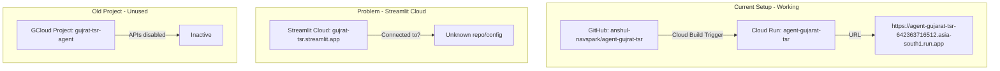

# Fix Streamlit Cloud App Pointing to Old Version

## Root Cause Analysis

Based on my investigation, I found:



**Key Findings:**

- **GCloud Projects Found:**
  - `neon-alcove-479309-q3` (CURRENT) - Has the working Cloud Run service `agent-gujarat-tsr`
  - `gujrat-tsr-agent` (OLD) - APIs are disabled, not in use
- **GitHub Repo:** `anshul-navspark/agent-gujrat-tsr` - correctly connected to Cloud Build
- **Cloud Run:** Deployed and working at `https://agent-gujarat-tsr-642363716512.asia-south1.run.app`
- **Git History:** Shows a deployment link change from old URL `gujrat-tsr-agent-*` to new URL `agent-gujarat-tsr-*`

**The Streamlit Cloud app (`gujrat-tsr.streamlit.app`) is likely:**

1. Connected to a different/old GitHub repo or fork
2. Connected to a different branch
3. Has outdated secrets configuration

---

## Fix Steps

### Step 1: Verify Streamlit Cloud Configuration (Manual)

Go to [share.streamlit.io](https://share.streamlit.io) and find the `gujrat-tsr` app. Check:

1. **Connected Repository:** Should be `anshul-navspark/agent-gujrat-tsr`
2. **Branch:** Should be `main`
3. **Main file path:** Should be `app/streamlit_app_cloud.py`

### Step 2: Update Streamlit Cloud Secrets

In the Streamlit Cloud dashboard, go to **Settings > Secrets** and ensure these values:

```toml
API_URL = "https://agent-gujarat-tsr-642363716512.asia-south1.run.app"
API_TIMEOUT = 1200
API_MAX_RETRIES = 2
GEMINI_API_KEY = "your-gemini-api-key"
```

The `API_URL` is critical - it must point to the current Cloud Run service.

### Step 3: If Connected to Wrong Repo - Delete and Recreate

If the app is connected to a different repo:

1. Delete the existing app from Streamlit Cloud
2. Create a new app:

   - Repository: `anshul-navspark/agent-gujrat-tsr`
   - Branch: `main`
   - Main file: `app/streamlit_app_cloud.py`

3. Configure secrets as shown in Step 2
4. Optionally request the custom subdomain `gujrat-tsr` again

### Step 4: Reboot the Streamlit App

After updating configuration:

1. Go to **Manage app > Reboot app** in Streamlit Cloud
2. Or trigger a redeploy by pushing a small change to the `main` branch

---

## Files Reference

- Streamlit app entry point: [app/streamlit_app_cloud.py](app/streamlit_app_cloud.py)
- Secrets template: [.streamlit/secrets.toml.example](.streamlit/secrets.toml.example)
- Cloud Build config: [cloudbuild.yaml](cloudbuild.yaml)

---

## Verification

After fixing, verify:

1. Visit `https://gujrat-tsr.streamlit.app` - should show updated UI
2. Check the app makes requests to `https://agent-gujarat-tsr-642363716512.asia-south1.run.app`
3. Test a simple record fetch to confirm end-to-end functionality